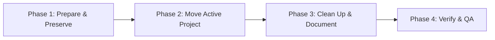
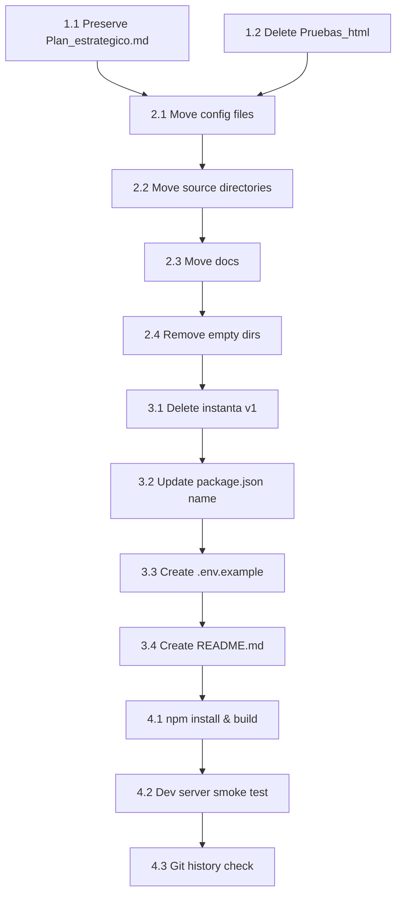

# Work Plan: Repository Restructure — Flatten to Standard Next.js Layout

## Table of Contents

- [Related Documents](#related-documents)
- [Objective](#objective)
- [Impact Scope](#impact-scope)
- [Implementation Plan](#implementation-plan)
- [Risks and Countermeasures](#risks-and-countermeasures)
- [Completion Criteria](#completion-criteria)
- [Progress Tracking](#progress-tracking)
- [Notes](#notes)

Created Date: 2025-02-21
Type: refactor
Estimated Impact: ~30 files (moved), 3 new files created
Related Issue/PR: N/A

## Related Documents
- Design Doc: N/A (small-scale restructure, no architecture changes)
- ADR: N/A (no technology decisions)
- PRD: N/A

## Objective

Flatten the Instanta repository from a two-level nested structure (`instanta/` v1 + `instanta2/instanta2/` v2) into a standard Next.js project at the repo root. This eliminates the obsolete v1 prototype, removes redundant directory nesting, and makes the project immediately recognizable as a standard Next.js application. As a TFG project, clean repository structure and documentation are essential for evaluation.

**No source code modifications are needed** — only file moves, deletions, and new documentation files.

## Impact Scope

### Files Moved (via `git mv`)
- `instanta2/instanta2/src/` → `src/`
- `instanta2/instanta2/convex/` → `convex/`
- `instanta2/instanta2/lib/` → `lib/`
- `instanta2/instanta2/public/` → `public/`
- `instanta2/instanta2/docs/` → `docs/` (merge with preserved v1 doc)
- `instanta2/instanta2/package.json` → `package.json`
- `instanta2/instanta2/package-lock.json` → `package-lock.json`
- `instanta2/instanta2/tsconfig.json` → `tsconfig.json`
- `instanta2/instanta2/next.config.ts` → `next.config.ts`
- `instanta2/instanta2/eslint.config.mjs` → `eslint.config.mjs`
- `instanta2/instanta2/postcss.config.mjs` → `postcss.config.mjs`
- `instanta2/instanta2/.gitignore` → `.gitignore`
- `instanta/docs/Plan_estrategico.md` → `docs/Plan_estrategico.md`

### Files Deleted
- `instanta/` — entire v1 prototype (except `docs/Plan_estrategico.md`, moved first)
- `instanta2/instanta2/Pruebas_html/` — test artifacts (7 HTML files)
- `instanta2/` — empty wrapper after moves

### Files Created
- `.env.example` — documents required environment variables
- `README.md` — project documentation (tech stack, setup, architecture)

### Files Modified
- `package.json` — rename `"name"` from `"instanta2"` to `"instanta"`

### Documentation
- [ ] README.md creation needed
- [ ] .env.example creation needed

## Phase Structure Diagram



## Task Dependency Diagram



## Implementation Plan

### Phase 1: Prepare & Preserve (Estimated commits: 1)
**Purpose**: Safeguard the one file from v1 that must survive and clean test artifacts before the big move.

#### Tasks
- [ ] **1.1** Copy `instanta/docs/Plan_estrategico.md` to a temporary safe location (or `git mv` directly to `docs/Plan_estrategico.md` via temp path)
- [ ] **1.2** Delete `instanta2/instanta2/Pruebas_html/` directory (7 test HTML files)

#### Phase Completion Criteria
- [ ] `Plan_estrategico.md` is preserved and tracked by git
- [ ] `Pruebas_html/` no longer exists

#### Operational Verification
1. `git status` shows the planned moves/deletes
2. `cat` the preserved file to confirm content intact

---

### Phase 2: Move Active Project to Root (Estimated commits: 1-2)
**Purpose**: Flatten `instanta2/instanta2/*` to repo root using `git mv` for history preservation.

#### Tasks
- [ ] **2.1** `git mv` config files to root: `package.json`, `package-lock.json`, `tsconfig.json`, `next.config.ts`, `eslint.config.mjs`, `postcss.config.mjs`, `.gitignore`
- [ ] **2.2** `git mv` source directories to root: `src/`, `convex/`, `lib/`, `public/`
- [ ] **2.3** `git mv` docs: `instanta2/instanta2/docs/project_memo.md` and `project_memo_2.md` to `docs/`
- [ ] **2.4** Remove empty `instanta2/` directory tree

#### Phase Completion Criteria
- [ ] All active project files live at repo root in standard Next.js layout
- [ ] `instanta2/` directory no longer exists
- [ ] `docs/` contains `Plan_estrategico.md`, `project_memo.md`, `project_memo_2.md`

#### Operational Verification
1. `ls` at repo root shows `src/`, `convex/`, `lib/`, `public/`, `package.json`, etc.
2. `git log --follow -- src/app/page.tsx` shows history from before the move

---

### Phase 3: Clean Up & Document (Estimated commits: 2-3)
**Purpose**: Remove the obsolete v1 prototype, update metadata, and create project documentation.

#### Tasks
- [ ] **3.1** Delete entire `instanta/` directory (v1 prototype — `Plan_estrategico.md` already moved)
- [ ] **3.2** Update `package.json`: change `"name": "instanta2"` to `"name": "instanta"`
- [ ] **3.3** Create `.env.example` with documented environment variables:
  ```
  # Convex serverless backend
  NEXT_PUBLIC_CONVEX_URL=

  # Clerk authentication
  NEXT_PUBLIC_CLERK_PUBLISHABLE_KEY=
  CLERK_SECRET_KEY=

  # Alchemy RPC (Base Sepolia) — optional, falls back to public RPC
  NEXT_PUBLIC_ALCHEMY_RPC_URL=
  ```
- [ ] **3.4** Create `README.md` covering:
  - Project description (TFG — crypto payment gateway)
  - Tech stack (Next.js 16, React 19, Convex, Clerk, wagmi/viem, Tailwind CSS 4, Base Sepolia)
  - Prerequisites (Node.js, Convex CLI, Clerk account)
  - Setup instructions (clone, `npm install`, env config, `npx convex dev`, `npm run dev`)
  - Project structure overview
  - Available scripts (`dev`, `build`, `start`, `lint`)

#### Phase Completion Criteria
- [ ] `instanta/` directory no longer exists
- [ ] `package.json` `name` field is `"instanta"`
- [ ] `.env.example` exists at root with all 4 variables documented
- [ ] `README.md` exists at root with complete setup instructions

#### Operational Verification
1. `git status` shows no unintended file changes
2. `.env.example` lists exactly the 4 required variables
3. `README.md` renders correctly (preview in editor)

---

### Phase 4: Verify & QA (Required) (Estimated commits: 1)
**Purpose**: Confirm the project works identically after restructuring.

#### Tasks
- [ ] **4.1** Run `npm install` — verify clean install with no errors
- [ ] **4.2** Run `npm run build` — verify Next.js build succeeds
- [ ] **4.3** Run `npm run dev` — verify dev server starts, app loads at `localhost:3000`
- [ ] **4.4** Run `npm run lint` — verify no lint errors
- [ ] **4.5** Verify `git log --follow` preserves history for key files (e.g., `src/app/page.tsx`, `convex/payments.ts`)
- [ ] **4.6** Verify final directory structure matches target layout
- [ ] **4.7** Commit all changes with descriptive message

#### Phase Completion Criteria
- [ ] `npm run build` exits 0
- [ ] `npm run lint` exits 0
- [ ] Dev server starts without errors
- [ ] Git history is preserved for moved files
- [ ] Repository root matches target structure exactly
- [ ] Single clean commit (or squashed PR) with descriptive message

#### Operational Verification
1. `npm run build` — expect clean exit
2. `npm run dev` — open `http://localhost:3000`, confirm app renders
3. `git log --follow -- src/app/page.tsx` — confirm historical commits visible
4. `tree -L 2 -I node_modules` — compare against target structure

## Risks and Countermeasures

| Risk | Likelihood | Countermeasure |
|------|-----------|----------------|
| **Import paths break after move** | Low — project uses `@/*` alias and relative paths within `src/` | Verify with `npm run build`; `tsconfig.json` paths config is relative and moves with the project |
| **Git history lost for moved files** | Low — using `git mv` | Verify with `git log --follow`; if needed, accept history break for this refactor |
| **Convex config expects specific project root** | Low — Convex uses `convex/` dir relative to `package.json` | Moving both together preserves the relationship |
| **`.gitignore` conflicts at root** | Low | The v2 `.gitignore` is comprehensive; v1 `.gitignore` stays inside the deleted `instanta/` dir |
| **Lock file inconsistency after move** | Medium | Run `npm install` fresh after move to regenerate if needed |

## Completion Criteria

- [ ] All 4 phases completed
- [ ] Each phase's operational verification procedures executed
- [ ] `npm run build` succeeds
- [ ] `npm run lint` succeeds
- [ ] Dev server starts and app loads
- [ ] Git history preserved for key files
- [ ] `.env.example` and `README.md` present and accurate
- [ ] `instanta/` and `instanta2/` directories fully removed
- [ ] No source code modifications made (purely organizational)

## Progress Tracking

### Phase 1: Prepare & Preserve
- Start:
- Complete:
- Notes:

### Phase 2: Move Active Project to Root
- Start:
- Complete:
- Notes:

### Phase 3: Clean Up & Document
- Start:
- Complete:
- Notes:

### Phase 4: Verify & QA
- Start:
- Complete:
- Notes:

## Notes

- **Git LFS**: `.gitattributes` at root configures LFS — this file stays untouched.
- **`.cursor/` and `.github/`**: These directories at root are untracked/new and unaffected by the restructure.
- **Convex `_generated/`**: This directory is auto-generated by Convex CLI and will regenerate on `npx convex dev`. It's gitignored.
- **No `src/` prefix in v1**: The v1 prototype put app code directly under `instanta/app/`. The v2 project correctly uses `src/app/`, which is the standard Next.js convention we're preserving.
- **`public/button.js` and `public/test-button.html`**: Both exist in v2's public dir and will move to root `public/`. These are kept for development testing of the payment button widget.
