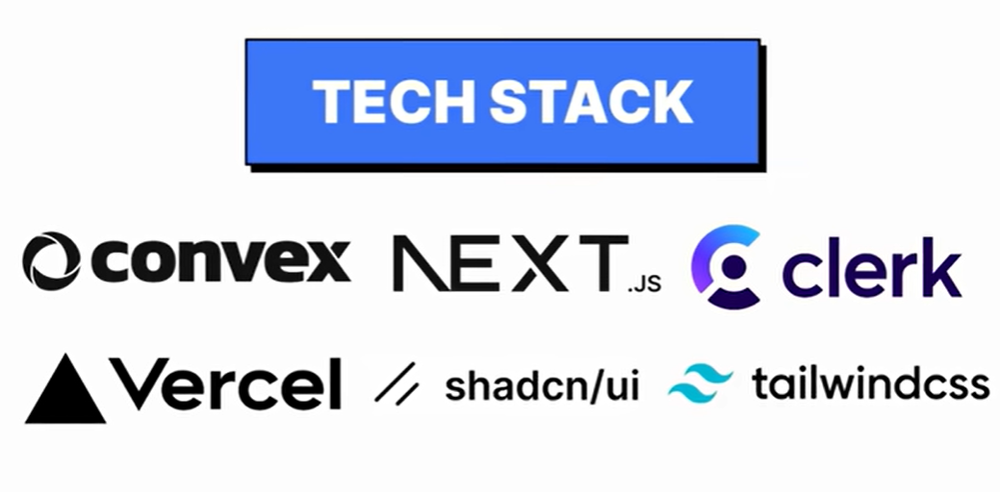

# Plan Estratégico Revisado: La Pasarela Más Simple del Mundo

Perfecto. Ahora que tenemos claridad en la dirección, voy a reconstruir completamente el plan con un enfoque láser en simplicidad y experiencia de usuario. Lo que voy a diseñar es algo radicalmente diferente a todo lo que existe en el mercado actual.

---

## 1. Resumen Ejecutivo Revisado

Construiremos la primera pasarela de pagos cripto que un creador de contenido puede integrar y usar en literalmente 60 segundos, sin registro, sin KYC, sin configuración. Un solo snippet de 3 líneas que genera un botón de pago para recibir USDC en Base (Layer 2), con detección instantánea de pagos y cero fricción tanto para el comerciante como para el comprador. Completamente gratis para ganar adopción viral entre creadores digitales.


<p align="center">
  
</p>

---

## 2. La Ventaja Competitiva (Por qué esto va a funcionar)

Déjame explicarte por qué este enfoque es superior a todo lo que existe actualmente en el mercado. Cuando analizamos las pasarelas existentes del documento que compartiste, todas caen en la trampa de intentar ser "completas". Coinbase Commerce quiere ser para todos, BitPay quiere soportar 150 monedas, CoinPayments tiene 2,300 criptomonedas. Pero en esa búsqueda de completitud, todas sacrificaron lo más importante: la simplicidad.

Nuestro insight clave es que un creador que vende un ebook por $29 no necesita un dashboard con gráficos de ventas por región geográfica. No necesita soporte para 50 criptomonedas diferentes. No necesita configurar webhooks con firmado HMAC. Solo necesita un botón que cuando alguien hace click, le permita pagar, y el creador recibe el dinero. Punto.

### La ventaja competitiva se construye en tres pilares inquebrantables:

**Pilar 1 - Simplicidad Radical**: Mientras que Coinbase Commerce requiere que crees una cuenta, conectes tu wallet, configures webhooks, instales plugins, y entiendas conceptos como "merchant ID" y "API keys", nuestra solución será: copia tres líneas de código, pégalas en tu HTML, funciona. No hay paso dos. Un creador que nunca ha tocado blockchain puede tener su botón de pago funcionando antes de que termine de leer este párrafo. Esta fricción cero es nuestra arma secreta para adopción viral.

**Pilar 2 - Costos Transparentes y Predecibles**: El documento que compartiste menciona repetidamente que uno de los mayores problemas es la incertidumbre de costos. Los usuarios pagan un producto de $29 pero terminan pagando $34 porque el gas fee fue inesperado. Esto causa carritos abandonados y frustración. Nosotros resolveremos esto usando Base, donde el gas fee es consistentemente menor a $0.50. Pero más importante aún, mostraremos el costo total exacto antes de que el usuario conecte su wallet. En pantalla grande dirá: "Total a pagar: $29.40 (incluye $0.40 de gas)". Cero sorpresas, cero frustración.

**Pilar 3 - Velocidad Obsesiva**: Las pasarelas actuales tardan entre 10 a 30 segundos en detectar un pago porque esperan confirmaciones en Ethereum mainnet. Nosotros usaremos Base (bloques de 2 segundos) más detección de mempool más confirmación de receipt. El resultado será que el usuario ve "¡Pago confirmado!" en menos de 5 segundos desde que hace click en su wallet. Esta inmediatez crea una experiencia mágica que genera word-of-mouth orgánico. La gente compartirá videos en Twitter diciendo "mira qué rápido fue esto".

Ahora, permíteme contrastar esto específicamente con los competidores principales del documento:

Coinbase Commerce es popular pero el documento menciona que no tiene ambiente de pruebas (sandbox) y los pagos quedan cargando indefinidamente cuando hay congestión. Nosotros tendremos sandbox desde el día uno y usaremos Base para evitar congestión.

BitPay cobra 1% y requiere procesos complejos. Nosotros seremos gratis y sin proceso de registro.

NOWPayments cobra desde 0.4% pero el documento menciona que su soporte es lento y tienen políticas de AML/KYC que bloquean pagos. Nosotros no tendremos KYC en el MVP (es técnicamente legal si no convertimos a fiat) y el soporte será en GitHub Discussions, transparente y comunitario.

CoinPayments es custodial y el documento reporta problemas graves recuperando fondos. Nosotros seremos no-custodial: los fondos van directo del comprador al creador, nunca tocamos el dinero.

---

## 3. MVP Ultraminimalista - Una Sola Feature Perfecta

Aquí es donde todo cambia. En lugar de construir diez features mediocres, vamos a construir UNA feature tan perfecta que la gente no pueda creer que sea gratis. Esta es la feature:

**Un Botón de Pago Universal que Cualquiera Puede Usar en 60 Segundos**

Déjame describir exactamente cómo funcionará esto desde la perspectiva del creador y del comprador, porque en los detalles está la magia.

### Experiencia del Creador (Tiempo total: 60 segundos)

Imagina que eres un diseñador que acaba de crear un pack de 50 iconos y quieres venderlos por $29. Visitas nuestra página web, inicias sesión con google en menos de 10 segundos y simplemente ves esto:

```
¿Cuánto quieres cobrar? → $29
¿Tu wallet address? → 0xtu_wallet_aqui
```

Haces click en "Generar código" y obtienes esto:

```html
<script src="https://pay.base/button.js"></script>
<div data-pay-amount="29" data-pay-to="0xtu_wallet"></div>
```

Lo copias, lo pegas en tu página de Notion, Carrd, Webflow, o donde sea que vendas tu producto, y ya está. Ya puedes cobrar en USDC. No creaste cuenta. No diste tu email. No configuraste nada. Simplemente funciona.

### Experiencia del Comprador (Tiempo total: 30 segundos)

Ahora imagina que eres alguien que quiere comprar ese pack de iconos. Ves el botón azul que dice "Comprar con USDC - $29". Haces click. Se abre un modal limpio y minimalista que dice:

```
Pack de 50 Iconos Premium
Precio: $29.00 USDC
Gas fee estimado: ~$0.40
Total: $29.40

[Conectar Wallet]
```

Haces click en "Conectar Wallet", se abre la extensión del MetaMask o Coinbase Wallet del ordenador y también aparece el QR por si lo quieres hacer desde el móvil, la apruebas, e inmediatamente se actualiza el modal para mostrar:

```
Confirma el pago en tu wallet
Enviando $29.40 USDC...
```

Confirmas en tu wallet. En menos de 5 segundos el modal se actualiza con una animación de confetti:

```
✅ ¡Pago Confirmado!
Tu transacción: 0xabc123...
Descarga tu producto aquí ↓
```

Toda esta experiencia toma 30 segundos. Es más rápida que sacar tu tarjeta de crédito y escribir los 16 dígitos. Es mágica.

### Criterios de Aceptación del MVP

Para considerar que el MVP está completo y listo para lanzar, debe cumplir estos criterios exactos:

Un creador puede copiar el snippet, pegarlo en cualquier página HTML y ver un botón funcional en menos de 60 segundos sin crear cuenta ni dar información personal.

El snippet debe ser exactamente tres líneas de código, no cuatro, no cinco. Tres es el número mágico porque psicológicamente la gente puede procesarlo de un vistazo sin sentirse intimidada.

Cuando un comprador hace click en el botón, el modal debe cargar en menos de 500 milisegundos. Cualquier cosa más lenta se siente como lag y rompe la sensación de inmediatez.

El modal/widget debe mostrar el costo total incluyendo gas ANTES de que el usuario conecte su wallet, no después. Este es crítico porque elimina la ansiedad de "cuánto voy a pagar realmente".

La detección del pago debe mostrar "Confirmado" en la pantalla del usuario en menos de 8 segundos desde que aprueba la transacción en su wallet. Esto requiere detección de mempool más polling agresivo del receipt.

El creador debe recibir el USDC directamente en su wallet sin que nosotros toquemos los fondos jamás. Cero custodio, cero riesgo, cero problemas regulatorios.

No debe haber absolutamente ningún paso de registro que tome más de 5 segundos, así que sólo autentificación con google. Hacemos que tengan sesión para que puedan guardar sus botones, con sus precios y todo creado, y dejar todo organizado en la base de datos para futuros avances en los que añadamos dashboard para cada usuario. Muy sencillo, que no puedan configurar nada, sólo administrar sus botones, y tampoco el aspecto, sólo la cantidad y la cartera a la que va a parar. Si es más completo, el MVP habrá fallado.

### Lo que NO está en el MVP

Es igual de importante definir qué NO vamos a construir, porque la tentación de agregar "solo una feature más" es enorme. Estas cosas quedan explícitamente fuera del MVP:

No habrá dashboard para ver historial de pagos. El creador verá sus transacciones directamente en Basescan o en su wallet. Si quiere un dashboard bonito, eso viene en versión 2.

No habrá webhooks. Los webhooks requieren que el creador tenga un servidor backend para recibirlos, lo cual rompe nuestra promesa de simplicidad máxima. En v2 podemos agregar webhooks opcionales.

No habrá múltiples monedas. Solo USDC en Base. Punto. Una moneda, una red, cero confusión. En la versión v2 o v3 añado también ETH para poder pagar, porque mucha gente no tendrá USDC.

No habrá sistema de cuentas, API keys, o autenticación. El snippet es anónimo y público. Cualquiera puede usarlo. Es importante que quien paga no pueda modificar el código del botón para enviárselo a sí mismo el dinero, porque entonces le saldría gratis la compra.

No habrá conversión a fiat. El creador recibe USDC y si quiere convertirlo a dólares lo hace en su exchange preferido.

No habrá protección contra fraude o disputas. Es blockchain, las transacciones son finales. Esto es feature, no bug, porque elimina el problema de contracargos que plaga a PayPal.

No habrá facturación automática, pagos recurrentes, o suscripciones. Eso es complejidad que agregamos después de validar el concepto básico.

---

## 4. Arquitectura Técnica Simplificada

Ahora voy a explicarte la arquitectura técnica, pero de una forma que realmente entiendas cómo las piezas encajan. Voy a usar una analogía del mundo real para cada componente.

### Componentes del Sistema

Piensa en nuestra aplicación como una tienda física. La tienda tiene varios empleados, cada uno con una responsabilidad específica. Déjame presentarte a cada uno:

**El Vendedor (Next.js Frontend)**: Este es el empleado que está en el mostrador hablando con los clientes. Cuando un comprador hace click en el botón "Comprar", el vendedor le muestra el modal bonito, le explica cuánto va a costar, y lo guía durante el proceso de pago. El vendedor vive en tu navegador y está escrito en React/Next.js. Su trabajo es hacer que la experiencia sea fluida y agradable.

**El Contador (Convex Database)**: Este empleado está en la oficina de atrás llevando el registro de todo. Cada vez que alguien crea un pago, el contador lo anota en su libro: "Pago #123, monto: $29, para wallet: 0xabc, estado: esperando". Cuando el pago se confirma, actualiza el libro: "Pago #123, estado: confirmado, txHash: 0x456". El contador tiene memoria perfecta y trabaja 24/7 sin cansarse. Usa Convex porque es una base de datos que automáticamente sincroniza todos los cambios en tiempo real, lo cual es perfecto para nuestro checkout que necesita actualizarse instantáneamente.

**El Inspector (Blockchain Listener)**: Este empleado tiene una sola misión: observar la blockchain de Base constantemente buscando transacciones que sean pagos de nuestra plataforma. Es como un guardia de seguridad mirando cámaras 24/7. Cuando ve una transacción que coincide con un pago que el contador tiene anotado como "esperando", inmediatamente le grita al contador "¡El pago #123 acaba de llegar!" y el contador actualiza su libro a "confirmado". El inspector usa conexión WebSocket con Alchemy para recibir notificaciones en tiempo real, más polling de eth_getTransactionReceipt cada 2 segundos para confirmar.

**La Fábrica de Botones (CDN Estático)**: Este no es un empleado, sino una máquina que produce botones de pago automáticamente. Cuando alguien pega nuestro snippet de 3 líneas en su página web, la máquina instantáneamente le entrega un botón funcional. La máquina está en un servidor CDN ultra rápido (como Vercel Edge) para que cargue en milisegundos sin importar dónde esté el usuario en el mundo.

### Flujo Completo Paso a Paso

Ahora déjame mostrarte exactamente qué sucede cuando un comprador hace click en "Comprar", paso por paso, con tiempos reales:

**T=0ms**: El comprador hace click en el botón azul "Comprar con USDC - $29" en la página del creador.

**T=50ms**: Nuestro JavaScript detecta el click y llama a una función para generar un nuevo paymentId único (usamos nanoid para generar algo como "pay_kx9f2j3l"). No necesitamos hacer llamada al servidor para esto, se genera en el navegador.

**T=100ms**: Abrimos el modal de pago. El modal muestra inmediatamente el monto ($29) y hace una llamada a Base para estimar el gas fee actual. Esto se hace con eth_estimateGas llamando al contrato de USDC.

**T=300ms**: Recibimos la estimación de gas (~$0.40) y actualizamos el modal para mostrar "Total: $29.40 (incluye $0.40 de gas)". También mostramos el botón "Conectar Wallet".

**T=1000ms**: El usuario hace click en "Conectar Wallet". Esto abre MetaMask o Coinbase Wallet pidiendo permiso para conectarse.

**T=3000ms**: El usuario aprueba la conexión en su wallet. Ahora tenemos su dirección (0xcomprador...).

**T=3100ms**: Creamos el documento en Convex con todos los detalles del pago: amount: 29, currency: "USDC", from: 0xcomprador, to: 0xcreador, status: "pending_signature", paymentId: "pay_kx9f2j3l". Esta escritura a Convex toma unos 100ms.

**T=3200ms**: Mostramos en el modal "Confirma el pago en tu wallet" y llamamos a wallet.sendTransaction con los parámetros para enviar 29 USDC al creador. Esto abre la ventana de confirmación en MetaMask.

**T=8000ms**: El usuario revisa los detalles en MetaMask (ve que va a pagar $29.40, ve la dirección del creador) y hace click en "Confirmar". MetaMask firma la transacción y la envía a la red Base.

**T=8200ms**: MetaMask nos devuelve el txHash (algo como 0x742d35Cc...). Inmediatamente actualizamos el documento en Convex: status: "pending_confirmation", txHash: "0x742d35Cc...". El modal ahora muestra "Procesando pago..." con un spinner.

**T=8500ms**: Nuestro inspector (Blockchain Listener) que está escuchando el mempool de Base via WebSocket recibe una notificación: "Nueva transacción detectada: 0x742d35Cc...". El inspector verifica si es una de nuestras transacciones buscando en Convex por ese txHash.

**T=8600ms**: ¡Match! El inspector encuentra que 0x742d35Cc es el pago pay_kx9f2j3l. Ahora empieza a hacer polling del receipt cada 2 segundos con eth_getTransactionReceipt.

**T=10000ms**: Primera llamada a eth_getTransactionReceipt. Base aún no ha minado el bloque, retorna null.

**T=12000ms**: Segunda llamada. El bloque fue minado (Base tiene bloques cada 2 segundos). El receipt existe y muestra status: "0x1" (éxito). El inspector actualiza Convex: status: "confirmed", blockNumber: 8523490, confirmations: 1.

**T=12100ms**: Como Convex sincroniza en tiempo real, el modal del comprador que está suscrito a ese documento inmediatamente recibe la actualización. El modal explota en confetti y muestra "✅ ¡Pago Confirmado!" con el link a Basescan.

Tiempo total desde que el usuario hizo click en "Comprar" hasta ver "Confirmado": aproximadamente 12 segundos. De esos 12 segundos, unos 5 segundos son el usuario leyendo y confirmando en MetaMask, lo cual es inevitable. El tiempo real de nuestro sistema procesando es solo 7 segundos, lo cual es increíblemente rápido comparado con las pasarelas actuales que tardan 30-60 segundos.

### Por qué esta arquitectura es la que queremos

Permíteme explicarte las decisiones técnicas clave y por qué cada una es la correcta para nuestros objetivos:

**Decisión 1 - Convex en lugar de PostgreSQL**: Podríamos usar una base de datos tradicional como PostgreSQL con Next.js API routes. Pero entonces necesitaríamos implementar WebSockets manualmente para que el checkout se actualice en tiempo real, necesitaríamos manejar polling del frontend, necesitaríamos preocuparnos por race conditions cuando múltiples procesos escriben simultáneamente. Convex nos da todo esto gratis: las queries son automáticamente reactivas (cuando cambias datos, todos los clientes suscritos se actualizan), las actions son transaccionales por defecto, y el hosting está incluido. Para un MVP es la elección perfecta porque podemos enfocarnos en la lógica de negocio en lugar de pelear con infraestructura.

**Decisión 2 - Base en lugar de Ethereum Mainnet**: Ya discutimos los costos ($0.40 vs $5), pero hay otro beneficio enorme: bloques de 2 segundos vs 12 segundos. Esto significa que nuestro inspector puede confirmar pagos 6 veces más rápido. Además Base tiene respaldo institucional de Coinbase, lo que da confianza. Y el TVL de $4.32 mil millones demuestra que hay liquidez y adopción real. Es una apuesta segura.

**Decisión 3 - USDC en lugar de ETH**: ETH es volátil. Si vendes algo por "0.01 ETH" hoy, mañana eso podría valer $28 o $32 dependiendo del mercado. Esto hace que la contabilidad sea una pesadilla para creadores. USDC siempre vale $1. Un creador que vende por "$29 USDC" sabe exactamente cuánto dinero va a recibir. Esto elimina toda la ansiedad relacionada con volatilidad que el documento menciona como un pain point mayor.

**Decisión 4 - Sin backend tradicional**: No tenemos servidores Node.js corriendo 24/7. Todo el backend vive en Convex (que es serverless) y el inspector blockchain es una Convex action que corre periódicamente. Esto significa cero mantenimiento de servidores, cero problemas de escalamiento, y costos casi cero hasta que tengamos miles de usuarios.

**Decisión 5 - CDN para el botón**: El snippet que los creadores pegan carga un JavaScript desde nuestro CDN. Esto significa que podemos actualizar el código del botón (agregar features, fix bugs) y automáticamente todos los botones en internet se actualizan sin que los creadores tengan que cambiar nada. Es deploy continuo sin fricción.

---

## 5. Implementación del Snippet Mágico de 3 Líneas

Ahora voy a mostrarte exactamente cómo funciona el snippet técnicamente. Esto es importante porque es nuestra interfaz con el mundo, nuestra "API" si quieres llamarlo así.

### El Snippet que el Creador Pega

```html
<script src="https://pay.base.your-domain.com/v1/button.js"></script>
<button data-pay-amount="29" data-pay-to="0xCreadorWallet" data-pay-currency="USDC">
  Comprar ahora
</button>
```

Sí, son 3 líneas. La primera línea carga nuestro JavaScript. Las siguientes 2-3 líneas (dependiendo de cómo las formatees) son el botón HTML con atributos data que especifican el monto, a quién pagar, y en qué moneda.

### Qué Hace ese JavaScript de Pago con Botón

Cuando el navegador carga `button.js`, nuestro código hace esto automáticamente:

Primero escanea toda la página buscando elementos que tengan el atributo `data-pay-amount`. Cuando encuentra uno, lo "mejora" agregándole event listeners y estilos.

Cuando el usuario hace click en ese botón, nuestro código intercepta el click y en lugar de hacer lo que haría un botón normal (nada o enviar un formulario), abre nuestro modal de pago.

El modal es un iframe que cargamos desde nuestro dominio. Usamos iframe por seguridad: así nuestro código tiene acceso a web3 pero está aislado del código del creador. Esto previene que algún script malicioso en la página del creador pueda interceptar claves privadas.

Dentro del iframe, tenemos nuestra aplicación React completa de checkout. Lee los atributos data del botón (amount, to, currency) y los usa para configurar el pago.

Todo esto sucede tan rápido que el usuario percibe que el modal se abrió instantáneamente al hacer click. No hay redirecciones a otras páginas, no hay recargas, solo una experiencia fluida.

### Por qué Este Diseño Es Superior

Comparado con competidores, nuestro approach es dramáticamente más simple:

Coinbase Commerce requiere que uses su hosted checkout page. Cuando el usuario hace click en pagar, lo redirige a una URL de Coinbase: `commerce.coinbase.com/charges/ABC123`. Esto rompe la experiencia porque el usuario sale de tu sitio, ve branding de Coinbase por todos lados, y después de pagar tiene que volver a tu sitio. Es jarring.

Stripe con criptos requiere que generes una Payment Intent desde tu backend, lo cual significa que necesitas tener un servidor. Esto elimina a todos los creadores que simplemente tienen un Notion page o un Carrd site.

Nosotros no requerimos backend. No hay redirecciones. Todo sucede inline con un modal bonito que mantiene al usuario en contexto. Y no ven nuestro branding (o apenas un "Powered by YourName" discreto), ven el branding del creador.

---

## 6. El Flujo de Usuario Detallado (UX Map Completo)

Déjame dibujar con palabras cada pantalla que verá el usuario, porque en una pasarela de pagos la UX es literalmente todo. Si agregamos un click extra o una pantalla confusa, perdemos conversiones.

### Pantalla 1: El Botón en la Página del Creador

El usuario está navegando la página del creador, quizás leyendo la descripción de un ebook. Ve un botón azul y limpio con texto blanco que dice "Comprar ahora - $29 USDC". El botón tiene un icono pequeño de una wallet a la izquierda del texto. Usa el azul característico de Base (#0052FF) para que sea recognizable para usuarios cripto.

Cuando el usuario pone el mouse sobre el botón (hover), el botón se vuelve ligeramente más oscuro y crece un 2% (transform: scale(1.02)). Este micro-interaction le dice al usuario "soy clickeable". Pequeños detalles como este aumentan conversiones.

### Pantalla 2: Modal de Conexión de Wallet

El usuario hace click. En 50ms se obscurece ligeramente el fondo (backdrop blur) y desliza desde abajo un modal limpio de 400px de ancho. El modal tiene fondo blanco, esquinas redondeadas, y una sombra suave. En la parte superior dice "Comprar Ebook Premium" (toma el título de un atributo opcional data-pay-title del botón).

Debajo muestra:
```
Precio: $29.00 USDC
Gas estimado: ~$0.40
────────────────────
Total: $29.40
```

El gas se muestra en gris más claro para indicar que es adicional. Debajo hay un botón grande "Conectar Wallet" con el icono de MetaMask. Más abajo en texto pequeño dice "Pago seguro en Base • Sin comisiones adicionales".

### Pantalla 3: Selección de Wallet (si el usuario tiene múltiples)

Cuando el usuario hace click en "Conectar Wallet", usamos la librería wagmi/viem que detecta automáticamente qué wallets tiene instaladas el usuario. Si tiene MetaMask, Coinbase Wallet, y Rainbow, mostramos los tres logos y el usuario elige cuál usar. Esto toma 1 segundo porque la detección es local.

La mayoría de usuarios solo tienen una wallet, entonces este paso se salta automáticamente.

### Pantalla 4: Confirmando en la Wallet

La wallet del usuario (digamos MetaMask) abre su popup. Aquí nosotros no controlamos la UI, es la UI nativa de MetaMask. El usuario ve:

```
Metamask
──────────
Enviando a: 0x742d...35Cc
Cantidad: 29 USDC
Gas: ~$0.40

[Rechazar] [Confirmar]
```

El usuario revisa que todo se vea correcto. La dirección del creador coincide, el monto es correcto. Hace click en Confirmar.

### Pantalla 5: Procesando Pago

MetaMask se cierra. El modal ahora muestra un spinner animado (usamos el spinner de Tailwind) y dice "Procesando tu pago..." con un texto más pequeño debajo: "Esto toma ~5 segundos". También mostramos el txHash con un link a Basescan para usuarios avanzados que quieran ver la transacción.

Aquí es donde la magia de Convex + blockchain listener trabaja en background. El usuario solo ve el spinner girando, pero detrás hay varios sistemas sincronizándose en tiempo real.

### Pantalla 6: Éxito con Confetti

¡POP! El spinner desaparece y explota confetti cayendo desde la parte superior del modal (usamos la librería canvas-confetti). El modal ahora muestra:

```
✅ ¡Pago Confirmado!

Tu compra está completa
Transacción: 0x742d...35Cc [Ver en Basescan]

[Descargar Ebook]
```

El botón "Descargar Ebook" es opcional. Si el creador especificó un atributo data-pay-success-url en el botón original, mostramos este botón que lleva a esa URL. Si no lo especificó, simplemente mostramos un mensaje de éxito.

El usuario puede cerrar el modal haciendo click en la X de arriba o presionando Escape. Toda la experiencia desde que hizo el primer click hasta ver el confetti fue aproximadamente 15 segundos, de los cuales 10 fueron él decidiendo y confirmando. Los 5 segundos de procesamiento se sienten instantáneos gracias al feedback visual constante.

---

## 7. Plan de Implementación por Fases (Revisado)

Ahora que entiendes el qué y el cómo, déjame darte un plan de implementación paso a paso que sea realista y alcanzable. Voy a dividir esto en sprints de una semana cada uno, con entregables concretos al final de cada sprint.

### Sprint 1: Fundación y Configuración (Semana 1)

**Objetivo**: Tener el proyecto funcionando localmente con todas las dependencias configuradas y la estructura base lista.

Ya completamos la mayor parte de esto en el setup inicial que hicimos antes, pero déjame ser específico sobre qué debemos validar:

Confirmar que Convex está sincronizando correctamente. Crea un pago dummy manualmente en Convex y verifica que puedes leerlo desde Next.js con useQuery. Esto valida que la conexión bidireccional funciona.

Conectar con Base testnet (Sepolia Base). Necesitas obtener tu API key de Alchemy específicamente para Base Sepolia. Crea una app nueva en Alchemy dashboard, selecciona "Base Sepolia" como network, y copia el HTTP endpoint y el WebSocket endpoint. Pégatelos en tu .env.local.

Conseguir USDC de testnet. Base Sepolia tiene faucets que te dan ETH y USDC falsos para probar. Visita el faucet oficial de Base, conecta tu wallet de prueba, y recibe ~10 USDC fake. Esto te permitirá hacer transacciones reales en testnet sin gastar dinero real.

Crear la estructura de carpetas refinada. Además de lo que ya tenemos, crea: `app/widget` (aquí vivirá el modal de pago), `lib/blockchain` (funciones para interactuar con Base), `lib/usdc` (el ABI del contrato de USDC y funciones específicas), `convex/payments` (las queries y mutations para pagos).

Escribir el esquema de Convex refinado. Ya tenemos uno básico, pero agreguémosle campos que definitivamente vamos a necesitar: `estimatedGas`, `userWallet`, `creatorWallet`, `network` (para poder soportar mainnet/testnet), y `completedAt`.

Al final de esta semana debes poder crear un pago en Convex manualmente y verlo reflejado instantáneamente en una página Next.js. Esto valida que el flujo de datos funciona.

### Sprint 2: El Botón y Modal Básico (Semana 2)

**Objetivo**: Tener un botón funcional que abra un modal, conecte wallet, y prepare una transacción (aunque aún no la envíe).

Construir el script `button.js` embebible. Este es el corazón de nuestra integración. El script debe escanear el DOM buscando elementos con `data-pay-amount`, agregar event listeners, y cuando detecte un click, abrir un iframe con nuestro checkout. Por ahora el iframe puede ser una página simple de Next.js en `/widget/checkout`.

Crear la página del checkout modal en `/widget/checkout`. Esta página recibe query params como `?amount=29&to=0xabc&currency=USDC` y los muestra. Por ahora solo muestra el monto y un botón dummy "Conectar Wallet". La página debe ser bonita: usa Tailwind para hacer un card centrado con sombras suaves, tipografía clara, y el esquema de colores de Base.

Integrar WalletConnect / wagmi para conexión de wallet. Usaremos la librería wagmi que es el estándar actual para apps Web3. Instala con `npm install wagmi viem @tanstack/react-query`. Configura el WagmiConfig en tu layout del widget para soportar Base testnet. Cuando el usuario haga click en "Conectar Wallet", debe abrir MetaMask y pedir permiso para conectarse.

Mostrar la dirección del usuario una vez conectado. Después de conectar, el modal debe mostrar "Conectado: 0x742d...35Cc" y cambiar el botón a "Preparar Pago". Esto le da feedback al usuario de que la conexión fue exitosa.

Estimar el gas fee real. Usa `estimateGas` de viem para calcular cuánto costará enviar el USDC. Muestra este costo en el modal: "Gas estimado: $0.42". Esto requiere llamar al contrato de USDC en Base con los parámetros de transferencia y ver cuánto gas retorna. Multiplica el gas por el precio actual del gas para obtener el costo en dólares.

Crear un pago en Convex cuando se abre el modal. Cuando el usuario hace click en el botón de pago original, antes de abrir el modal, genera un `paymentId` único y créalo en Convex con status `pending_wallet`. Pasa este `paymentId` como query param al modal: `/widget/checkout?paymentId=pay_abc123`. Ahora el modal puede leer ese pago de Convex y actualizarlo conforme avanza el proceso.

Al final de esta semana deberías poder hacer click en un botón en cualquier página HTML, ver abrirse un modal bonito, conectar tu wallet de prueba, y ver el costo total incluyendo gas. Aún no enviamos la transacción real, pero toda la UI está funcionando.

### Sprint 3: Transacciones Reales (Semana 3)

**Objetivo**: Poder enviar una transacción real de USDC en Base testnet y ver el txHash.

Obtener el ABI del contrato USDC de Base. USDC es un contrato ERC-20 estándar. Necesitamos el ABI (Application Binary Interface) que describe las funciones del contrato. Puedes obtenerlo de Basescan buscando el contrato de USDC en Base Sepolia. Crea un archivo `lib/usdc/abi.ts` y exporta el ABI como una constante.

Implementar la función de transferencia. Usando viem, crea una función `sendUSDC(to, amount)` que llame al método `transfer` del contrato USDC. Esta función debe preparar la transacción, pedirle al usuario que la firme en su wallet, y retornar el txHash una vez enviada. Maneja errores comunes: usuario rechaza la transacción, fondos insuficientes, gas insuficiente.

Actualizar Convex cuando se envía la transacción. Una vez que tenemos el txHash, actualiza el documento del pago en Convex: `status: "pending_confirmation"`, `txHash: "0xabc..."`, `sentAt: Date.now()`. Esto debe suceder inmediatamente después de que la transacción se envíe, incluso antes de que se confirme en la blockchain.

Mostrar el estado en el modal en tiempo real. Como Convex se sincroniza automáticamente, el modal que está leyendo ese pago con `useQuery` debe actualizarse automáticamente cuando cambies el status. Implementa diferentes estados visuales: "pending_wallet" muestra "Conecta tu wallet", "pending_confirmation" muestra el spinner con "Procesando...", "confirmed" muestra el confetti.

Hacer una transacción de prueba end-to-end. Toma tu wallet de testnet que tiene USDC fake, haz click en el botón, confirma en MetaMask, y verifica en Basescan que la transacción se envió correctamente. El USDC debe llegar a la wallet del creador que especificaste en el botón. Si esto funciona, has logrado el 70% del MVP.

Al final de esta semana puedes demostrar una transacción completa: click → conectar → enviar → ver txHash. Es básico pero funcional.

### Sprint 4: Detección Automática y Confirmación (Semana 4)

**Objetivo**: Implementar el blockchain listener que detecta automáticamente cuando un pago se confirma y actualiza el UI sin que el usuario tenga que refrescar.

Crear una Convex action para polling de receipts. Las actions en Convex son funciones que pueden llamar APIs externas. Crea `convex/blockchain/pollReceipt.ts` que reciba un txHash, llame a `eth_getTransactionReceipt` via Alchemy, y si el receipt existe, actualice el pago a `status: "confirmed"`. Esta action debe correr cada 2 segundos para cada pago que esté en `pending_confirmation`.

Implementar un cron job en Convex. Convex permite definir funciones que corren periódicamente. Crea una que cada 5 segundos busque todos los pagos con status `pending_confirmation` y para cada uno llame a `pollReceipt`. Esto asegura que estamos constantemente monitoreando transacciones pendientes sin necesidad de tener un servidor tradicional corriendo.

Conectar con WebSocket de Alchemy para mempool. Para detección más rápida, conecta con el WebSocket de Alchemy y suscríbete a eventos de transacciones pendientes. Cuando detectes una transacción que coincida con uno de nuestros pagos (verificando el `to`, `from`, y `value`), actualiza el status a `processing` para dar feedback inmediato. Esto es opcional pero agrega esa sensación de "wow, es súper rápido".

Agregar la animación de confetti. Instala `canvas-confetti`: `npm install canvas-confetti`. Cuando el modal detecte que el pago cambió a `confirmed`, dispara el confetti con `confetti()`. Hazlo explosivo y celebratorio porque este es el momento cumbre de la experiencia. También reproduce un sonido corto de éxito si el usuario tiene audio habilitado (opcional pero memorable).

Agregar botón de éxito opcional. Si el creador especificó `data-pay-success-url="https://ejemplo.com/descargar"` en el botón original, muestra un botón grande "Descargar tu producto" que redirija ahí. Si no lo especificó, solo muestra el mensaje de éxito con el link a Basescan.

Probar el flujo completo 10 veces. Haz transacciones reales en testnet repetidamente para asegurarte de que el sistema es robusto. Intenta casos edge: qué pasa si el usuario cierra el modal mientras la transacción está pendiente (debería poder volver a abrirlo y ver el estado actualizado), qué pasa si rechaza la transacción (debería poder intentar de nuevo), qué pasa si MetaMask tarda mucho (debería mostrar un timeout amigable después de 30 segundos).

Al final de esta semana tienes un sistema completamente funcional end-to-end. Un creador puede pegar el snippet, un comprador puede pagar, y el sistema detecta y confirma automáticamente. Esto ES el MVP.

### Sprint 5: Polish y Landing Page (Semana 5)

**Objetivo**: Hacer que todo se vea profesional, crear la landing page para que creadores descubran el producto, y preparar para el lanzamiento.

Diseñar la landing page. Crea una página en `/` que explique el producto en 5 segundos. El hero debe decir algo como: "Acepta pagos en USDC en 60 segundos. Sin registro. Sin comisiones. Solo pega 3 líneas de código." Debajo muestra el snippet exacto que van a copiar, con un campo donde pueden poner su wallet address y genera el código personalizado al instante. Esto les permite probarlo sin fricción.

Crear un generador de snippet interactivo. En la landing page, agrega un formulario simple: "¿Cuánto quieres cobrar?" → campo de texto para el monto, "¿Tu wallet address?" → campo para la wallet. Cuando llenan esos dos campos, debajo automáticamente se genera el snippet con esos valores pre-llenados. Agrega un botón "Copiar código" que copie al clipboard con un solo click. Esto hace que la adopción sea instantánea.

Agregar una demo en vivo. En la misma landing page, pon un botón de ejemplo que diga "Prueba comprando un café digital - $3". Cuando hacen click, experimentan el flujo completo de pago (pero usando una wallet dummy nuestra, no cobran realmente). Esto permite que cualquiera entienda cómo funciona sin necesidad de instalar MetaMask. Es el mejor onboarding posible.

Escribir documentación mínima. Crea una página `/docs` con tres secciones: "Inicio rápido" (cómo pegar el código), "Personalización" (qué atributos data- están disponibles), y "FAQ" (responde las 5 preguntas más comunes). Mantén la documentación brutalmente corta, máximo 200 palabras por sección. Si necesitas más palabras para explicar algo, significa que el producto es muy complicado y debes simplificarlo.

Implementar analytics básico. Usa Vercel Analytics (incluido gratis con Vercel hosting) para trackear: cuántas personas visitan la landing page, cuántas copian el snippet, y cuántos pagos se completan exitosamente. No necesitas Google Analytics con toda su complejidad, solo métricas básicas para entender si la gente está usándolo.

Pulir la UI del modal. Revisa cada píxel del modal de pago. Los bordes deben estar perfectamente redondeados, los colores deben ser consistentes con el brand de Base, las animaciones deben ser suaves (usa `transition-all duration-300` de Tailwind), los textos deben estar perfectamente alineados. La diferencia entre un producto que se ve amateur y uno que se ve profesional está en estos detalles.

Agregar manejo de errores amigable. Si algo falla (el RPC está caído, el usuario no tiene USDC, la transacción se revierte), muestra mensajes de error que un humano normal pueda entender. En lugar de "Error: execution reverted", di "No tienes suficiente USDC en tu wallet. Necesitas al menos $29.40". Incluye links a soluciones: "Comprar USDC en Coinbase" si no tienen fondos.

Al final de esta semana tienes un producto listo para mostrar al mundo. Puedes compartir el link en Twitter, Product Hunt, Reddit, y empezar a conseguir usuarios reales.

---

## 8. Estrategia de Lanzamiento: Cómo Conseguir los Primeros 100 Usuarios

Un producto perfecto que nadie conoce no vale nada. Déjame darte una estrategia concreta para conseguir tracción inicial sin presupuesto de marketing.

### Fase 1: Los Primeros 10 Usuarios (Semana 6)

**Táctica: Outreach Personal Hiperespecífico**

No intentes conseguir usuarios masivamente todavía. En lugar de eso, encuentra 10 creadores específicos que encajen perfectamente y contáctalos personalmente. Aquí está el perfil exacto que debes buscar:

Creadores de contenido técnico que ya venden productos digitales y tienen audiencia cripto. Por ejemplo, busca en Twitter cuentas que tweeteen sobre desarrollo web/crypto y que en su bio tengan un link a Gumroad o Lemon Squeezy vendiendo templates, cursos, o ebooks. Estos son perfectos porque ya entienden crypto y ya están vendiendo cosas.

Usa una herramienta como Twitter Advanced Search: "gumroad OR lemon squeezy (developer OR creator)" y filtra por cuentas con 1,000-10,000 seguidores. No busques los mega influencers todavía, busca gente en crecimiento que esté abierta a experimentar con herramientas nuevas.

Envíales un DM ultra personalizado. No copies y pegues el mismo mensaje a todos. Mira qué están vendiendo específicamente, cómpralo si es barato, y luego diles algo como: "Hey, compré tu template de landing pages y es genial. Vi que usas Gumroad, ¿has considerado aceptar pagos en cripto? Construí una pasarela que se integra en literalmente 60 segundos, sin comisiones. ¿Quieres que te ayude a configurarlo gratis?" 

Ofrece hacerlo por ellos. No solo les des el link y esperes que lo configuren solos. Di "Si me das acceso a tu página, puedo agregarlo en 5 minutos y te muestro cómo funciona". Esto elimina toda fricción y te garantiza que realmente lo usen.

Cuando lo configures, pídeles que tweeteen sobre la experiencia. Algo como "Acabo de agregar pagos en cripto a mi sitio en literalmente 60 segundos con @TuProducto. Cero comisiones, cero configuración. Esto es lo que el web3 debería ser." Un tweet así de alguien con audiencia relevante vale más que mil anuncios pagados.

Con estos 10 usuarios, tu objetivo no es dinero (es gratis de todos modos), tu objetivo es testimonios, feedback, y casos de uso reales para refinar el producto.

### Fase 2: Los Primeros 100 Usuarios (Semanas 7-8)

**Táctica: Launch en Comunidades Relevantes**

Con 10 usuarios usando el producto y contentos, ya tienes prueba social. Ahora puedes lanzar en comunidades más grandes.

Product Hunt: Programa tu lanzamiento para un martes o miércoles (los días con más tráfico). Tu tagline debe ser ultra clara: "Acepta pagos en cripto con 3 líneas de código - sin comisiones, sin registro". En la descripción, enfatiza el problema que resuelves (las pasarelas actuales son complicadas y caras) y por qué eres diferente (literalmente 60 segundos de setup). Incluye un GIF mostrando el proceso completo desde copiar el código hasta recibir un pago. Pide a tus 10 primeros usuarios que comenten y upvoteen cuando lances.

Hacker News: Crea un post tipo "Show HN: Pasarela de pagos cripto que instalas en 60 segundos". La comunidad de HN es técnica y valora la simplicidad. Enfatiza aspectos técnicos interesantes: cómo usas Convex para realtime sin WebSockets manuales, cómo detectas pagos en <5 segundos, por qué elegiste Base sobre Ethereum mainnet. Responde todos los comentarios rápido y honestamente, incluso los críticos. HN puede darte cientos de usuarios técnicos en un día si resonas con ellos.

Reddit - r/SideProject, r/webdev, r/cryptocurrency: En r/SideProject puedes hacer un post normal mostrando tu proyecto. En r/webdev enfócate en el aspecto de integración simple para developers. En r/cryptocurrency enfoca en cómo esto ayuda a la adopción masiva de crypto. Cada subreddit tiene diferentes motivaciones, ajusta tu mensaje. No hagas spam, contribuye genuinamente a discusiones relacionadas durante unos días antes de postear tu proyecto.

Discord de creadores: Únete a servidores de Discord para creadores digitales y freelancers. Por ejemplo, los Discords de Gumroad, ConvertKit, o comunidades de indie hackers. Participa en conversaciones, ayuda a otros con sus preguntas, y cuando sea relevante menciona tu herramienta. Algo como "Si estás buscando alternativas a Stripe con menos comisiones, construí esto... [link]" es natural y no se siente como spam.

### Fase 3: Growth Orgánico (Semanas 9+)

**Táctica: Convertir Usuarios en Evangelistas**

Una vez que tienes 100 usuarios, tu enfoque cambia. Ya no necesitas conseguir cada usuario manualmente. Ahora optimizas para que cada usuario traiga más usuarios.

Agrega "Powered by [TuNombre]" en el modal de pago. Cuando un comprador paga usando tu pasarela, ve un pequeño texto abajo del modal: "Powered by SimplePay" con un link a tu sitio. Esto es viralidad inherente: cada pago que se procesa es publicidad gratuita. Los comerciantes no pueden removerlo en el MVP (es parte del trato de que sea gratis), pero hazlo discreto y con buen diseño para que no se sienta intrusivo.

Crea un programa de referidos simple. En tu landing page, agrega una sección "Comparte con otros creadores" con un link único para cada usuario. Por cada creador que se una usando su link, ambos reciben... ¿qué? Dado que es gratis, no puedes dar descuentos. En su lugar, ofrece features premium adelantados: "Invita 3 creadores y desbloquea webhooks personalizados" o "Invita 5 y obtienes un dashboard con analytics avanzado". Esto incentiva sharing sin cobrar.

Documenta tu proceso de construcción públicamente. Tweetea threads mostrando decisiones técnicas interesantes, números de adopción, feedback de usuarios, retos que enfrentaste. La gente ama seguir el journey de productos indie. Usa hashtags como #buildinpublic y #indiehackers. Esto construye una audiencia que se siente parte del proceso y evangélicamente comparte tu producto.

Escribe content técnico útil. Publica artículos en tu blog (o Medium, o Dev.to) sobre temas relacionados: "Cómo implementar pagos en Base con ethers.js", "Por qué elegimos Convex sobre PostgreSQL para nuestra startup", "UX best practices para Web3 commerce". Estos artículos atraen tráfico orgánico de Google, establecen autoridad técnica, y mencionan tu producto naturalmente como ejemplo.

---

## 9. Monetización Futura (Post-MVP)

Dijimos que el MVP es gratis, pero eventualmente necesitas un modelo de negocio sostenible. Déjame darte opciones claras para monetizar sin romper la promesa de simplicidad.

### Opción 1: Freemium con Límites de Volumen

El tier gratuito permite hasta $10,000 en volumen de pagos por mes. Para la mayoría de creadores pequeños esto es más que suficiente. Si vendes ebooks a $29, eso son 344 ventas al mes antes de alcanzar el límite. La mayoría de creadores nunca llegarán a eso, pero los que sí, claramente tienen un negocio exitoso y pueden pagar.

El tier premium cuesta $29/mes (flat fee, no porcentaje) y da volumen ilimitado, webhooks personalizables, dashboard con analytics, y soporte prioritario. La clave aquí es que el flat fee es predecible y justo. No importa si procesas $50k o $500k, pagas lo mismo. Esto es dramáticamente mejor que BitPay cobrando 1% de cada transacción.

### Opción 2: Features Premium Opcionales

La funcionalidad básica (el botón de pago simple) es gratis forever, sin límites. Pero cobras por features avanzados que solo negocios más sofisticados necesitan:

Webhooks ($9/mes): Recibe notificaciones POST a tu backend cuando ocurren pagos. Esto es necesario si quieres automatizar fulfilment de productos digitales desde tu servidor.

Dashboard con analytics ($19/mes): Ve gráficos de ventas por día/semana/mes, productos más vendidos, tasas de conversión, etc. El creador promedio no necesita esto, pero cuando creces sí lo valoras.

Múltiples wallets de destino ($9/mes): Permite que diferentes productos vayan a diferentes wallets. Útil si tienes partners o quieres separar ingresos de diferentes líneas de producto.

White-label ($49/mes): Remueve el "Powered by Instanta" del modal y personaliza los colores del brand. Para creadores serios que quieren que toda la experiencia sea su marca.

La belleza de este modelo es que un creador puede empezar gratis, crecer su negocio usando tu herramienta, y cuando realmente le genera valor, upgrade a features que necesita. No hay fricción al inicio, pero capturas valor cuando demuestras valor.

### Opción 3: Servicios Adicionales

En lugar de cobrar por la pasarela en sí, ofrece servicios relacionados que algunos usuarios necesitarán:

Conversión a fiat: Partner con un exchange y ofrece conversión automática de USDC a USD con depósito bancario. Cobra 0.5% por este servicio, que es competitivo comparado con BitPay's 1%. Esto solo lo usarán usuarios que no quieren lidiar con crypto ellos mismos.

Facturación y contabilidad: Genera facturas PDF automáticas para cada pago (útil para taxes), integración con QuickBooks o Xero. Cobra $19/mes por esto. Los freelancers que facturan clientes corporativos necesitan esto para compliance.

---

## 10. Riesgos Refinados y Mitigaciones Específicas

Ahora que tenemos un plan detallado, revisemos los riesgos con mitigaciones más específicas para nuestra arquitectura, porque tiene problemas de seguridad gordos, el más gordo actualmente es que **alguien cambie manualmente el código inspeccionando el elemento**, tendré que implementar algo para que esto no lo puedan hacer:

**Riesgo 1: Transacción confirmada pero revertida (receipt.status = 0)**

Este es el riesgo técnico más crítico. Un usuario envía la transacción, nuestro sistema la detecta en el mempool, pero cuando se mina el bloque, la transacción falla (por ejemplo, aprobación de USDC insuficiente o gas demasiado bajo).

Mitigación: Siempre verificar `receipt.status === "0x1"` antes de marcar como confirmed. Si `receipt.status === "0x0"`, actualizar a `status: "failed"` y mostrar mensaje claro al usuario: "Tu pago falló. Los fondos no se movieron de tu wallet. [Intentar de nuevo]". También agregar un paso preventivo: antes de enviar la transacción, verificar que el usuario tiene suficiente USDC aprobado para el contrato. Si no, primero pedir aprobación con `approve()`, luego enviar el transfer.

**Riesgo 2: RPC provider caído (Alchemy outage)**

Si Alchemy tiene una interrupción, no podemos detectar transacciones ni obtener receipts. Nuestro sistema queda ciego temporalmente.

Mitigación: Configurar fallback automático a un segundo provider (Infura o Quicknode). En el código del blockchain listener, si una llamada a Alchemy falla con timeout o error de red, automáticamente reintenta con el provider de backup. Implementar esto con un simple try-catch: `try { await alchemy.getReceipt() } catch { await infura.getReceipt() }`. También monitorear uptime de ambos providers con un servicio como UptimeRobot y recibir alertas si ambos están caídos simultáneamente (extremadamente raro).

**Riesgo 3: Usuario cierra el modal antes de que confirme**

El usuario abre el modal, ve el costo, pero cambia de opinión y cierra el modal sin confirmar. El pago queda en Convex con status `pending_wallet` forever.

Mitigación: Implementar auto-expiración. Cuando creamos un pago, set `expiresAt: Date.now() + 15 * 60 * 1000` (15 minutos). El cron job de Convex que corre cada 5 minutos debe buscar pagos con `status: "pending_wallet"` y `expiresAt < Date.now()` y marcarlos como `expired`. Esto mantiene la base de datos limpia. También, si el usuario vuelve a hacer click en el mismo botón de pago, reusar el pago pendiente en lugar de crear uno nuevo (verificar si existe un pago no-expirado para ese monto/wallet y abrirlo).

**Riesgo 4: Gas fee sube dramáticamente entre estimación y envío**

Estimamos el gas en $0.40, el usuario ve ese número, pero para cuando confirma en MetaMask (20 segundos después), la red se congestionó y el gas real es $2. El usuario se siente engañado.

Mitigación: Re-estimar gas justo antes de enviar la transacción, no solo al abrir el modal. Cuando el usuario hace click en "Confirmar Pago", hacer una llamada final a `estimateGas()` con los parámetros actuales. Si el gas cambió por más de 20%, mostrar un warning: "⚠️ El gas subió a $0.75. ¿Continuar de todos modos?" y dar opción de cancelar. También, en Base el gas es tan bajo y estable que este riesgo es mínimo comparado con Ethereum mainnet.

**Riesgo 5: Fraude o abuso del sistema gratuito**

Alguien podría intentar spamear nuestra plataforma creando miles de pagos falsos para sobrecargar Convex o intentar exploits para robar fondos.

Mitigación: Dado que somos no-custodial, no hay fondos que robar de nosotros. Los fondos van directamente del comprador al creador, nunca los tocamos. Para prevenir spam de pagos: implementar rate limiting en el endpoint que crea pagos (máximo 10 pagos por IP por hora usando Vercel Edge Config). Para prevenir abuse de Convex: las cuentas gratuitas de Convex tienen límites generosos pero no infinitos; monitorear el usage y si alguien crea 10,000 pagos en un día, bloquearlo manualmente. Como plan B, si el spam se vuelve problema, requerir un CAPTCHA invisible (hCaptcha) antes de crear un pago.

---

## 11. Roadmap Post-MVP (Versiones 2.0, 3.0...)

Una vez que el MVP está funcionando y tiene tracción, ¿qué sigue? Déjame darte un roadmap de evolución natural del producto.

### Versión 2.0 - Webhooks y Dashboard (3 meses después del launch)

Los usuarios piden dos cosas una vez que empiezan a procesar pagos de verdad: recibir notificaciones automáticas y ver histórico de ventas.

Implementar webhooks firmados con HMAC. Cuando un pago se confirma, hacer POST al `callbackUrl` del creador con el payload firmado. Esto permite automatización: el creador recibe el webhook, verifica la firma, y automáticamente envía el producto digital o marca la orden como pagada en su sistema.

Construir un dashboard simple. Requiere que el usuario conecte su wallet (usando Sign-In with Ethereum) para probar ownership. Una vez autenticado, mostrar tabla de todos sus pagos: fecha, monto, status, txHash. Permitir filtrar por fecha y exportar a CSV para contabilidad. Esto no necesita ser sofisticado, solo funcional.

### Versión 3.0 - Múltiples Tokens (6 meses)

Después de validar Product-Market Fit con USDC, expandir a otros tokens populares.

Agregar USDT (Tether): Es la otra stablecoin mayor. Muchos usuarios prefieren USDT por liquidez. La implementación es casi idéntica a USDC, solo cambia el contrato address.

Agregar ETH nativo: Algunos creadores quieren recibir ETH directamente para holdear. La experiencia es similar pero la transacción es más simple (no requiere llamar a un contrato, es transfer directo).

Permitir que el creador elija en el snippet: `data-pay-currency="USDC,USDT,ETH"` y en el modal el usuario puede seleccionar con cuál prefiere pagar. Mostrar el equivalente en cada token basado en precio actual de Coingecko.

### Versión 4.0 - Expansión a Otras Chains (12 meses)

Una vez dominamos Base, expandir a otras L2s y eventualmente L1s.

Agregar Arbitrum: Es la L2 con mayor TVL. Similar a Base en costos y velocidad.

Agregar Optimism: Otro L2 popular con buena adopción.

Agregar Polygon: Tiene muchísima adopción retail, especialmente fuera de USA.

La arquitectura debe refactorizarse para ser chain-agnostic. Cada chain tiene su propio RPC provider, su propio USDC contract address, pero la lógica de negocio es la misma.

---

## 12. Métricas de Éxito del MVP

Para saber si estamos en el camino correcto, necesitamos medir cosas específicas. Estas son las métricas que importan en los primeros 3 meses:

**Métrica #1: Time to First Payment**
Target: <5 minutos desde que el creador descubre el producto hasta que recibe su primer pago de prueba. Esto mide nuestra promesa de simplicidad. Si toma 30 minutos, algo está mal con el onboarding.

**Métrica #2: Checkout Completion Rate**
Target: >50% de usuarios que abren el modal completan el pago. Esto mide la fricción del checkout. Si está bajo 40%, probablemente el gas fee asusta a la gente o la UX del modal es confusa.

**Métrica #3: Detection Latency P95**
Target: <10 segundos para el percentil 95. Es decir, 95% de los pagos deben mostrarse como "Confirmado" en menos de 10 segundos. Esto mide nuestra promesa de velocidad.

**Métrica #4: Weekly Active Creators**
Target: Crecimiento 10% semana-sobre-semana. Si esto está flat, significa que nadie está recomendando el producto. Si está creciendo, tenemos word-of-mouth.

**Métrica #5: Total Payment Volume**
No es la métrica más importante (recuerda que es gratis), pero indica engagement real. Target: $10k en volumen total procesado en el primer mes, $50k en el tercer mes.

---

## Resumen Ejecutivo Final

Hemos diseñado algo radicalmente simple en un mercado que ha normalizado la complejidad. Mientras Coinbase Commerce, BitPay, y otros intentan ser todo para todos, nosotros seremos el mejor en una cosa: hacer que un creador pueda empezar a cobrar en cripto en literalmente 60 segundos.

La ventaja competitiva no es tecnología misteriosa. Es el enfoque obsesivo en remover fricción. Tres líneas de código vs. 30 minutos de setup. Gratis vs. 1% de comisión. Sin KYC vs. verificaciones que tardan días. $0.40 de gas vs. $5+. Confirmación en 5 segundos vs. 30 segundos.

El mercado objetivo está claro: 207 millones de creadores digitales que venden productos de información. Estos son indie hackers, freelancers, educadores, diseñadores que ya venden en Gumroad, Lemon Squeezy, o su propio sitio web. Muchos ya están en cripto o cripto-curiosos. Solo necesitan una herramienta que no requiera un PhD en blockchain para usar.

El plan técnico es alcanzable: 5 sprints de una semana cada uno nos llevan de setup a lanzamiento. Next.js + Convex + Base + ethers.js. Stack moderno, confiable, y específicamente elegido para simplicidad y velocidad.

La monetización viene después de la adopción. Empezamos gratis para eliminar toda fricción, construimos una base de usuarios leales que aman el producto, y luego cobramos por features premium que agregan valor real.
